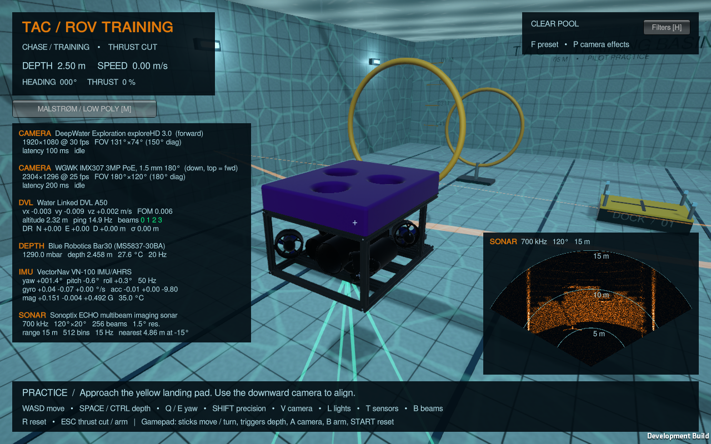
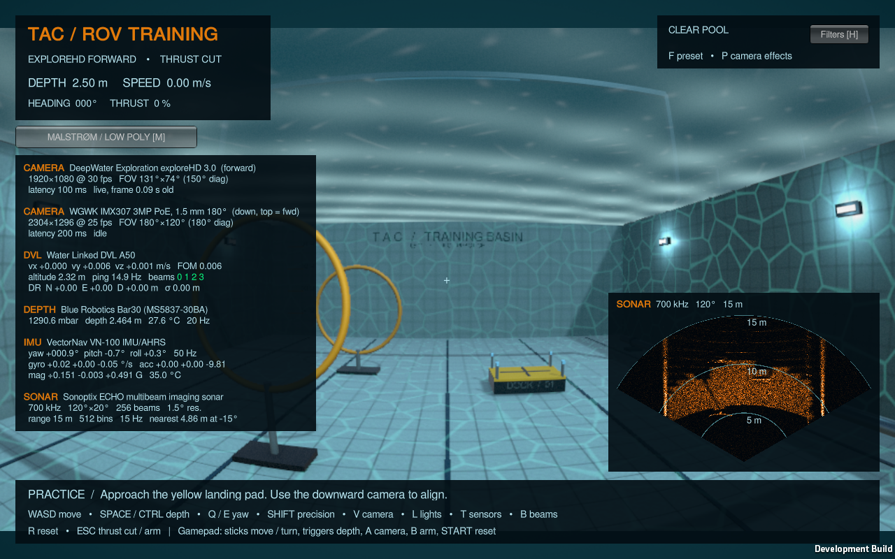
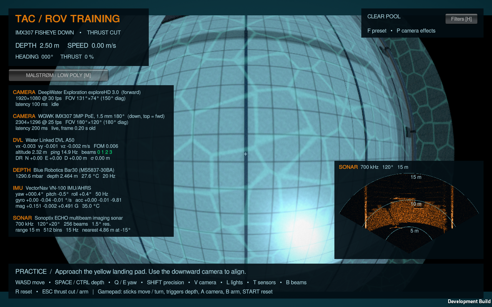

# Sensor suite

The simulator carries the Malstrøm payload: two cameras, a DVL, a depth sensor, an
IMU/AHRS and a multibeam imaging sonar. `SensorSuite` installs them on the vehicle
when the scene loads, so the scene file does not need regenerating. A sensor
already placed in the scene under the same mount name is kept, with its inspector
values. All sensors are available to the pilot overlay and to the
[automation API](AUTOMATION.md).

| exploreHD forward camera | IMX307 fisheye, downward |
| --- | --- |
|  |  |

## Controls

| Action | Keyboard | Gamepad |
| --- | --- | --- |
| Toggle sensor telemetry and sonar fan | T | D-pad up |
| Toggle DVL beams and sonar footprint in the scene | B | D-pad down |
| exploreHD / IMX307 view | V cycles chase → exploreHD → IMX307 | South / A |

## Conventions

- **Body frame (FRD):** X forward, Y starboard, Z down, right-handed, as used by
  the DVL A50 and VN-100. Unity is left-handed (X right, Y up, Z forward); the
  conversion is `SensorFrames.ToFrd`.
- **World frame (NED):** pool north is Unity +Z, east is +X. Headings are
  clockwise from pool north, pitch is nose-up and roll is starboard-down.
- **Time:** physics sensors sample on the 50 Hz fixed step and report
  `Time.fixedTimeAsDouble`; cameras report the game time of the delivered frame.
- **Noise and seeds:** every error comes from a seeded generator. The suite seed
  defaults to 1. Set it with `-sensorSeed N`, or send a non-zero `seed` with an
  API `reset` to draw new per-unit errors (biases, scale factors, offsets) for
  each episode. `-noSensorNoise` or API `sensor_noise: "off"` gives truth plus
  quantisation, which suits a training curriculum.

## Sensors

Mount positions are FRD metres from the hull centre. They are plausible
placements on the 0.41 × 0.32 × 0.52 m Malstrøm frame, **not measured from the
vehicle**. Correct them in `SensorSuite.Configure` once the payload layout is fixed.

| Sensor | Mount (FRD) | Rate | Outputs |
| --- | --- | --- | --- |
| DeepWater Exploration exploreHD 3.0 | (0.27, 0, −0.02), forward | 30 fps | 1920×1080 fisheye video |
| WGWK IMX307 3MP PoE/ONVIF, 1.5 mm 180° | (0.15, 0, 0.15), pitched −90° (down), image top = forward | 25 fps | 2304×1296 fisheye video |
| Water Linked DVL A50 | (−0.05, 0, 0.18), aligned with hull | 4–15 Hz, adaptive | velocity, FOM, altitude, 4 transducers, dead reckoning |
| Blue Robotics Bar30 / Bar100 | (−0.24, 0, −0.06), rear end cap | 20 Hz | pressure, depth, temperature |
| VectorNav VN-100 | (0.05, 0, 0), inside enclosure | 50 Hz | specific force, angular rate, magnetic field, attitude |
| Sonoptix ECHO | (0.27, 0, 0.08), pitched −15° | 15 Hz (≤ 25) | range × beam intensity image, per-beam range scan |

### Cameras: exploreHD 3.0 and WGWK IMX307

Both are equidistant fisheyes (`r = f·θ`). Each frame renders five 90° faces
around the mount and re-projects them through the lens model in
`FisheyeProjection.shader`. Field of view, the image circle and corner cropping
therefore follow the optics instead of a perspective approximation. Frames get
radial lens shading and signal-dependent sensor noise, and pass through a latency
buffer, so a capture returns the frame the real pipeline would deliver at that
moment.

- **exploreHD 3.0:** 1/2.9" Sony CMOS, 1920×1080 at 30 fps, 150° diagonal *in
  water* (f = 841 px). That gives about 131° × 74°. Latency is 100 ms.
- **IMX307:** 2.9 µm pixels behind a 1.5 mm lens; the "3MP" stream is the ISP's
  2304×1296 upscale, so f = 621 px. The 180° image circle spans the full width
  but crops to about 120° vertically, and the sides outside the circle are black.
  Latency is 200 ms, typical for RTSP/H.265.
- **Port assumption:** the IMX307 lens is specified in air. The model assumes a
  **dome port**, which preserves its field. Behind a flat port, refraction narrows
  it to about 97°; set `portRefraction = 1.333` to simulate that.
- The cameras render at 960 px wide for performance and report their native
  format. They exclude the vehicle's own geometry. Post-processing (bloom, grain,
  vignette) is replaced by the sensor model; scene fog, lighting, caustics and
  particles still apply.

### Water Linked DVL A50

Four 1 MHz beams in a convex Janus array, 22.5° from the axis, at azimuths 45°,
135°, 225° and 315° (transducers 0–3: forward-starboard, aft-starboard, aft-port,
forward-port). Each beam is raycast against the pool. The floor, walls and props
all give lock. A beam is valid within 0.05–50 m altitude and below 70° incidence.
Beam velocity is the transducer's velocity over ground along the beam, with
3 mm/s + 0.4 % ping noise and a per-unit scale error drawn so that 2σ equals the
Standard version's ±1.01 %.

With three or four valid beams, velocity is solved by least squares. FOM is the
propagated beam noise. The ping rate falls from 15 Hz near the bottom to 4 Hz at
50 m. Above the surface there is no lock. Dead reckoning integrates the velocity
with an internal heading that drifts 2° RMS. Reports use Water Linked's field
names: `vx`, `vy`, `vz`, `fom`, `altitude`, `velocity_valid`, `status`, and per
transducer `velocity`, `distance`, `rssi`, `nsd` and `beam_valid`.

### Blue Robotics Bar30 / Bar100

Hydrostatic pressure at the mount, from the vehicle's water density. Select the
variant with `-pressureSensor bar100`; Bar30 is the default.

| | Bar30 (MS5837-30BA) | Bar100 (Keller 4LD) |
| --- | --- | --- |
| Resolution | 0.2 mbar (2 mm) | 3 mbar (3 cm) |
| Noise | 0.2 mbar RMS | 1.5 mbar RMS |
| Unit offset (3σ) | ±200 mbar | ±500 mbar |
| Temperature accuracy | ±1 °C | ±2 °C |

Depth uses a power-on surface calibration, as ArduSub does (997 kg/m³
freshwater). The absolute offset therefore cancels, while slow drift (2 or 4 mbar
RMS) and quantisation remain. Temperature follows the 27 °C pool water with a 4 s
lag.

### VectorNav VN-100

Raw outputs are body FRD at 50 Hz, the physics rate; the hardware runs up to
800 Hz.

- **Accelerometer:** specific force, reading Z ≈ −9.81 m/s² at rest.
  0.14 mg/√Hz noise and 0.04 mg in-run bias stability.
- **Gyro:** 0.0035 °/s/√Hz noise and 5 °/h bias stability.
- **Magnetometer:** 140 µGauss/√Hz noise, with an approximate southern-Norway
  field (0.51 G, 73° inclination) and seeded hard iron.

The AHRS attitude is truth plus 2° RMS heading error and 0.5° RMS pitch/roll
error. Sustained horizontal acceleration leaks into pitch and roll (30 %), as in
a gravity-referenced filter, giving about 1° under manoeuvres; this matches the
dynamic specification. The vehicle's pitch and roll are locked by the physics
model, so real tilt is always zero.

### Sonoptix ECHO multibeam imaging sonar

256 beams over 120° × 20° at 700 kHz (≤ 30 m, 1.5° angular resolution) or 90° at
400 kHz (≤ 200 m, 2.5°). The minimum range is 0.2 m. Each beam is a column of 20
rays across the vertical aperture, run as one `RaycastCommand` batch. Echoes are
built in these steps:

1. Each ray is weighted by a Gaussian vertical beam pattern and by incidence, so
   walls are bright and the grazing floor is dim.
2. Returns are spread in range between neighbouring rays on the same surface.
3. Returns are smeared across beams to the angular resolution.
4. Exponential speckle and a noise floor are added.

The water surface reflects. The output is log-compressed `uint8`, range bins ×
beams (row 0 nearest, column 0 port), at `range / 512` per bin. The hardware
resolves 8 mm. Two simplifications: the ping rate is limited by 25 Hz and the
two-way travel time, and multipath is not simulated. `beam_ranges` gives the
first strong return per beam, a 256-value scan suited to compact policy inputs.

## Limits

These are physically motivated sensor models for training and integration, not
calibrated digital twins:

- Specifications come from the vendors' public datasheets.
- Error magnitudes not stated there (turn-on biases, DVL ping noise, sonar
  backscatter) are engineering estimates.
- The acoustic sensors use ray casting: no beam-width integration beyond the
  sampled rays, no multipath, no sound-speed profile, and no thruster
  interference.
- Mount poses and the IMX307 port type must be confirmed against the vehicle.

Sources: [exploreHD 3.0](https://geo-matching.com/products/explorehd-2-0-underwater-rov-auv-usb-camera),
[DVL A50](https://www.blueyerobotics.com/specsheet/WL-DVL-A50/pdf),
[Bar30](https://www.robotshop.com/products/bar30-high-resolution-300m-depth-pressure-sensor-r2) /
[Bar100](https://eu.robotshop.com/products/bar100-high-resolution-1000m-depth-pressure-sensor-r3),
[VN-100](https://www.vectornav.com/products/VN-100),
[Sonoptix ECHO](https://bluerobotics.com/?p=175127).
